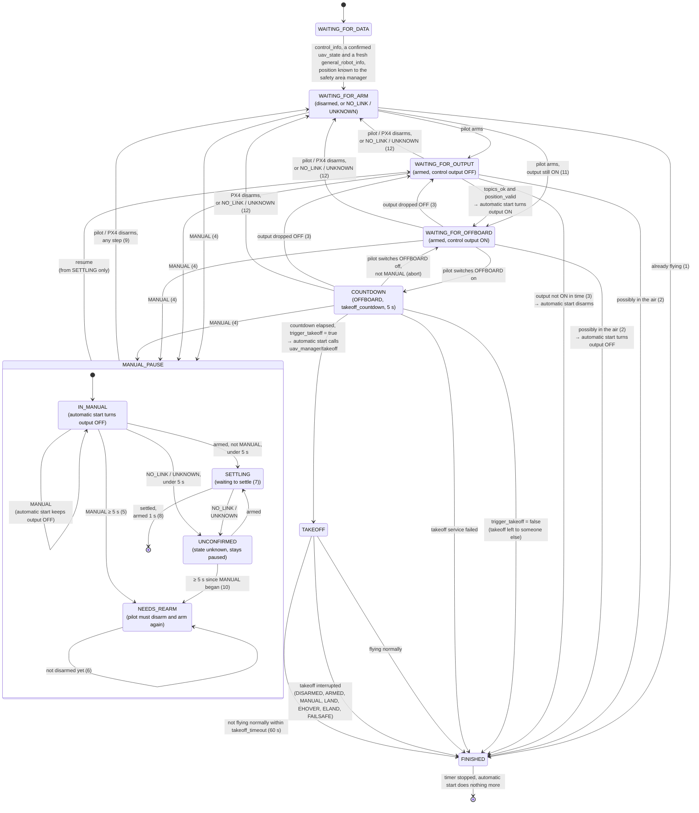

# MRS UAV Autostart

Please follow to the [documentation page](https://ctu-mrs.github.io/docs/features/autostart/).

## Changes compared to the original version

Compared to the ROS1 version (`master`) and to the first ROS2 port (`ros2` before automatic start
was moved onto DiagnosticsManager):

- **Inputs**: automatic start reads only DiagnosticsManager (`uav_state`, `control_info`,
  `general_robot_info`) and, in simulation, the Gazebo spawner. It no longer subscribes to the HW
  API, EstimationManager, ControlManager, UavManager or SafetyAreaManager.
- **Preflight checks** (speed, height, gyro, topics, position in the safety area) are computed by
  DiagnosticsManager and read from `general_robot_info.preflight_status`. The `preflight_check/*`
  parameters moved to `mrs_uav_managers` (`config/public/diagnostics_manager/preflight_check.yaml`)
  with the same defaults; automatic start no longer reads them from its own config.
- **Already flying**: if MRS already flies the UAV (e.g. the node was restarted mid-air), automatic
  start finishes without touching control output, arming or takeoff. Before, it counted down and
  called `uav_manager/takeoff`, which UavManager refused (it requires `NullTracker`), so automatic
  start finished on a failed takeoff.
- **The pilot takes over (`MANUAL`)**: new. Automatic start turns control output OFF and pauses.
  After a short `MANUAL` (an aborted OFFBOARD, under 5 s) it resumes; after a longer one the pilot
  must disarm and arm again. Before, there was no pause: the "possibly in the air" check finished
  automatic start for good.
- **Disarming by automatic start**: still only when it cannot turn control output ON within
  `arm_to_output_timeout` (1.5 s). The timeout now counts from entering `WAITING_FOR_OUTPUT` (the
  pilot armed, a resume, or the output dropped OFF) and waits until the DiagnosticsManager data is
  available, and automatic start never disarms a UAV that the pilot armed before automatic start
  came up. Before, it counted from the arming, so such a UAV was disarmed 1.5 s after the data
  arrived, and a short output dropout long after arming disarmed right away.
- **Control output ON is requested once**: after toggle_output accepts it, automatic start waits
  `output_on_confirm_timeout` (1 s) for ControlInfo to show it before asking again. Before, it
  asked on every tick until ControlInfo caught up, and ControlManager logged "already ON".
- **Explicit states**: the old `IDLE` is split into the states below, and every state change is
  logged at INFO, together with `>>>`/`<<<` lines around each service call.
- **Takeoff monitoring**: after calling `uav_manager/takeoff`, automatic start finishes when the
  takeoff is interrupted (`DISARMED`, `ARMED`, `MANUAL`, `LAND`, `EHOVER`, `ELAND`, `FAILSAFE`) or
  the UAV is not flying normally within `takeoff_timeout` (60 s). Before, it waited for the takeoff
  forever.
- **Stale data**: if DiagnosticsManager stops publishing `general_robot_info` for
  `diagnostics_manager_timeout` (3 s), automatic start pauses until the data is back. Before, the
  data only had to arrive once.
- **Errorgraph**: missing data is reported as waiting for DiagnosticsManager. The first ROS2 port
  reported each manager separately; the ROS1 version had no errorgraph.
- **Parameters**: new `manual_resume_timeout` (5 s), `takeoff_timeout` (60 s),
  `diagnostics_manager_timeout` (3 s), `output_on_confirm_timeout` (1 s) and `manual_resume_delay`
  (1 s); `preflight_check/*` removed (see above). Since the first ROS2
  port: `safety_timeout` is `takeoff_countdown`, `handle_takeoff` is `trigger_takeoff`,
  `control_output_timeout` is `arm_to_output_timeout`, `pre_takeoff_sleep` and `body_frame_name` are
  gone, and an old parameter name in a custom config stops the node.
- **Topic renamed**: `~/can_takeoff` is now `~/ready_to_enable_control_output` (same meaning: topics
  ok and position valid).
- **After finishing** (since the first ROS2 port): the node stays alive and does nothing; the ROS1
  version shut itself down.

## State machine

This section describes how `automatic_start` behaves (`src/automatic_start.cpp`, `timerMain()`,
running at `main_timer_rate`). It reads everything from DiagnosticsManager (`uav_state`,
`control_info`, `general_robot_info`). Automatic start itself only turns control output ON and OFF
(`control_manager/toggle_output`), disarms the UAV in one case (`hw_api/arming`, note 3) and calls
`uav_manager/takeoff`. It never arms the UAV and never switches OFFBOARD: arming, OFFBOARD, flying
in `MANUAL` and disarming are done by the pilot (and PX4 may disarm by itself after a landing).

Every tick of `timerMain()` runs, in this order:

1. `checkDataReady()`, in every state: until `control_info`, a confirmed `uav_state` (not
   `NO_LINK`/`UNKNOWN`) and a `general_robot_info` with `preflight_status.position_known` have
   arrived, the tick does nothing and reports DiagnosticsManager in the errorgraph.
   `general_robot_info` must also be fresh: if it is older than `diagnostics_manager_timeout`
   (3 s), e.g. because DiagnosticsManager died, every state (`TAKEOFF` too) pauses until the data
   is back. `WAITING_FOR_DATA` is drawn, but it is this check, not a state of its own.
2. In `TAKEOFF`, only the takeoff is watched (`stateTakeoff()`), nothing below.
3. `ready_to_enable_control_output` (`topics_ok` and `position_valid`) is published.
4. `checkAlreadyFlying()` (note 1).
5. `checkManual()` (note 4): enters `MANUAL_PAUSE`; while paused, `stateManualPause()` handles
   the tick and nothing below runs.
6. The state is set from the current inputs (armed? control output ON? OFFBOARD?), so a missed
   reading can't leave automatic start in a stale state.
7. `checkPossiblyInTheAir()` (note 2).
8. The handler of the state (`stateWaitingForArm()`, `stateWaitingForOutput()`,
   `stateCountdown()`).

Each state change is logged (`switching states A -> B`, `MANUAL_PAUSE: A -> B`).

Notes:

1. **Already flying**: `uav_state` is `TAKEOFF`, `HOVER`, `GOTO`, `TRAJECTORY`, `LAND`, `RC_MODE`,
   `MIDAIR`, `EHOVER`, `ELAND` or `FAILSAFE` — someone else started the flight (e.g. the node was
   restarted mid-air, or MRS is taking over a UAV already in the air). Automatic start finishes
   without touching output, arming or takeoff, from any waiting state or `MANUAL_PAUSE`. `MANUAL`
   does not count as already flying, see `MANUAL_PAUSE` below.
2. **Possibly in the air**: not OFFBOARD, a preflight speed / height / gyro check failed, and the
   UAV is armed. If automatic start turned control output ON, it turns it OFF again, then finishes.
   While **not armed** it only warns and keeps waiting. This check can't fire during a
   `MANUAL_PAUSE` (`checkManual()` runs first), and the `SETTLING` wait (note 7) keeps it from
   firing right after a resume.
3. **Output not ON in time**: toggle_output did not accept an ON within `arm_to_output_timeout`
   (1.5 s) of entering `WAITING_FOR_OUTPUT` (the pilot armed, a resume, or the output dropped OFF)
   or of the data becoming available, e.g. because a topic check or the safety area check fails.
   Automatic start then disarms the UAV and finishes. This is the only case in which it disarms. It
   does not disarm if the UAV was already armed when automatic start came up: then it only warns and
   keeps waiting. An accepted ON is not repeated for `output_on_confirm_timeout` (1 s), as
   ControlInfo shows it only a moment later; a refused repeat lets the timeout fire again.
4. **`MANUAL`**: the pilot (or the autopilot itself) is flying without offboard. Automatic start
   keeps control output OFF for the whole pause, so MRS can't take over when the pilot switches
   OFFBOARD on again (it would find no setpoints). `uav_state == MANUAL` requires the UAV to be
   armed, so `WAITING_FOR_ARM` reaches `MANUAL_PAUSE` only when the `MANUAL` follows a
   `NO_LINK`/`UNKNOWN` reading, or when automatic start comes up while the pilot flies manually.
5. **Long `MANUAL`**: a `MANUAL` that lasts `manual_resume_timeout` (5 s by default) or longer
   is treated as a real flight, not an aborted OFFBOARD attempt. To use automatic start again, the
   pilot must disarm and arm again.
6. Only a disarm by the pilot or PX4 (`uav_state` `DISARMED`) ends `NEEDS_REARM`;
   `NO_LINK`/`UNKNOWN` are ambiguous (not a confirmed landing) and leave the pause exactly where it
   was. A `MANUAL` reading in `SETTLING`/`UNCONFIRMED` goes back to `IN_MANUAL` (not drawn); the 5 s
   keeps counting from when the first `MANUAL` began.
7. **`SETTLING`**: once a short `MANUAL` ends, resuming is deferred while the preflight
   speed/height/gyro heuristics still say "possibly in the air" and the UAV isn't OFFBOARD yet —
   otherwise resuming would immediately trip the "possibly in the air + armed" finish check (note 2)
   right after the pause.
8. Resume requires `armed` to be stable (uninterrupted) for `manual_resume_delay` (1 s) once
   `SETTLING`'s condition clears. The state after the resume follows from the inputs, normally
   `WAITING_FOR_OUTPUT`.
9. A disarm by the pilot or PX4 ends the pause from any step (short or long) and automatic start
   continues from `WAITING_FOR_ARM`, so the pilot's next arm is a fresh start (the arm-to-output
   timeout counts from the new arming). `started_armed_` is **not** reset — it is latched once,
   from the first confirmed `uav_state` at node startup, so automatic start never disarms a UAV
   that the pilot armed before automatic start came up, even after a pause.
10. **`UNCONFIRMED`**: during a short pause, `NO_LINK`/`UNKNOWN` keeps automatic start paused (it
    warns "paused, UAV state not confirmed"). The pilot may still be flying without automatic start
    seeing it, so once `manual_resume_timeout` has passed since the `MANUAL` began, the pilot
    must disarm and arm again, just like after a long `MANUAL`. The time is measured from when the
    `MANUAL` began, so it includes any time already spent in `SETTLING`: a `NO_LINK`/`UNKNOWN`
    reading ≥ 5 s after the `MANUAL` began needs a rearm straight away. A long `SETTLING` while
    confirmed armed (not `MANUAL`) never requires a rearm by itself.
11. ControlManager does not turn control output OFF when the pilot disarms, so after a disarm and
    a new arming the output is usually still ON and automatic start goes straight to
    `WAITING_FOR_OFFBOARD`.
12. `NO_LINK`/`UNKNOWN` is not a confirmed arming, so the state goes to `WAITING_FOR_ARM` and
    automatic start does nothing until a confirmed reading comes back. The arm-to-output timeout
    then starts over, but the gap keeps the OFFBOARD time, so the countdown does not restart.

- `COUNTDOWN` restarts after a data gap, so the pilot always sees the full countdown. In a Gazebo
  simulation it also waits for the spawner to finish before taking off or finishing; the countdown
  keeps running meanwhile, so a slow spawner shortens it.
- Automatic start never disarms the UAV while it is in OFFBOARD; if the arm-to-output timeout
  fires then, it finishes without disarming ("disarming failed").
- `FINISHED` is final: to use automatic start again, restart the node.

### Transitions and the tests that cover them

The simulation tests are in `test/<name>/`. How every `uav_state` is classified
(`include/mrs_uav_autostart/state_checks.hpp`: confirmed, armed, flown by MRS, takeoff interrupted)
and the "possibly in the air" preflight check are unit-tested in `test/state_checks`.

| Transition                                                                                                                                   | Test (`test/`)                                                                                          |
|----------------------------------------------------------------------------------------------------------------------------------------------|---------------------------------------------------------------------------------------------------------|
| Obsolete parameter in `custom_config` (`mrs_uav_autostart/preflight_check`): the node refuses to start                                       | `obsolete_preflight_check_should_refuse_to_start` (error logged, exit code 1)                           |
| `WAITING_FOR_DATA` → `WAITING_FOR_ARM`                                                                                                       | `errorgraph_clears_after_startup` (waiting-for-DiagnosticsManager error reported, then cleared)         |
| Every state pauses (`checkDataReady()`): `general_robot_info` older than `diagnostics_manager_timeout`, until it is back                     | `stale_diagnostics_manager_should_pause` (no takeoff, no interrupted takeoff on stale data)             |
| `WAITING_FOR_ARM` → `FINISHED`: already flying                                                                                               | `already_flying_should_finish`                                                                          |
| `MANUAL_PAUSE` → `FINISHED`: already flying (`MIDAIR`), control output turned ON by UavManager is left alone                                 | `midair_activation_should_finish`                                                                       |
| `WAITING_FOR_ARM` → `WAITING_FOR_OUTPUT` → `WAITING_FOR_OFFBOARD`                                                                            | `takeoff_should_succeed`                                                                                |
| `WAITING_FOR_OUTPUT`/`OFFBOARD` → `WAITING_FOR_ARM`: the pilot disarms (outside a `MANUAL` pause)                                            | `disarm_should_start_over` (the pilot disarms with output ON, then a normal takeoff after arming again) |
| `WAITING_FOR_OUTPUT` stays: `topics_ok` false                                                                                                | `topic_check_failure_should_disarm` (output never ON, takeoff fails, automatic start disarms)           |
| `WAITING_FOR_OUTPUT` stays: position outside the safety area                                                                                 | `outside_safety_area_should_disarm` (output never ON, takeoff fails, automatic start disarms)           |
| `WAITING_FOR_ARM` stays: possibly in the air while not armed, only warns                                                                     | `possibly_in_the_air_unarmed_should_wait` (then a normal arming turns output ON)                        |
| `WAITING_FOR_OUTPUT`/`OFFBOARD` → `FINISHED`: possibly in the air + armed                                                                    | `takeoff_should_fail_while_moving`, `possibly_in_the_air_unarmed_should_wait` (output ON, turned OFF)   |
| Armed by the pilot before automatic start came up: output ON, takeoff                                                                        | `started_armed_should_take_off`                                                                         |
| Armed by the pilot before automatic start came up: automatic start does not disarm on the arm-to-output timeout                              | `started_armed_should_not_disarm`                                                                       |
| `WAITING_FOR_OFFBOARD` → `COUNTDOWN` → `TAKEOFF` → `FINISHED` (flying normally)                                                              | `takeoff_should_succeed`                                                                                |
| `COUNTDOWN` → `FINISHED`: `trigger_takeoff = false`                                                                                          | `trigger_takeoff_off_should_finish`                                                                     |
| `WAITING_FOR_OUTPUT`/`OFFBOARD`/`COUNTDOWN` → `MANUAL_PAUSE` (`IN_MANUAL`): `MANUAL`                                                         | `manual_flight_should_pause` (long), `short_manual_should_resume` (short, from `COUNTDOWN`)             |
| `IN_MANUAL` → `IN_MANUAL`: output forced OFF on every tick while `MANUAL`                                                                    | `manual_flight_should_pause`                                                                            |
| `IN_MANUAL` → `NEEDS_REARM`: `MANUAL` ≥ 5 s                                                                                                  | `manual_flight_should_pause`                                                                            |
| `NEEDS_REARM` → `NEEDS_REARM`: `NO_LINK` doesn't end the pause                                                                               | `manual_flight_should_pause`                                                                            |
| `NEEDS_REARM` → `WAITING_FOR_ARM`: the pilot disarms, fresh start after arming again                                                         | `manual_flight_should_pause`                                                                            |
| `IN_MANUAL` → `UNCONFIRMED` → `NEEDS_REARM`: short `MANUAL` (~2 s) + long `NO_LINK` (~5.5 s), then `ARMED` doesn't resume                    | `manual_flight_should_pause`                                                                            |
| `IN_MANUAL`/`SETTLING`/`UNCONFIRMED` → `WAITING_FOR_ARM`: the pilot disarms during a short pause                                             | `short_manual_disarm_should_start_over` (from each step, a fresh start after arming again)              |
| `IN_MANUAL` → `SETTLING`: `MANUAL` ends before 5 s                                                                                           | `short_manual_should_resume`                                                                            |
| `SETTLING` → resume (armed stable 1 s) → `WAITING_FOR_OUTPUT`/`OFFBOARD` → `COUNTDOWN` (restarted, no takeoff for the first 3 s) → `TAKEOFF` | `short_manual_should_resume`                                                                            |
| `WAITING_FOR_OUTPUT` → `FINISHED`: arm-to-output timeout → automatic start disarms                                                           | `outside_safety_area_should_disarm`, `topic_check_failure_should_disarm`                                |
| `COUNTDOWN` → `WAITING_FOR_OFFBOARD`: the pilot switches OFFBOARD off *without* `MANUAL`, then on again                                      | `offboard_abort_should_restart_countdown` (countdown restarted, no takeoff for the first 4 s)           |
| `SETTLING` → `SETTLING`: stays because speed/height/gyro not ok, also past 5 s since `MANUAL` began                                          | `settling_should_wait_for_preflight` (resumes 1 s after they are ok, countdown restarted)               |
| `COUNTDOWN` → `FINISHED`: takeoff service failed                                                                                             | `takeoff_failure_should_finish`                                                                         |
| `TAKEOFF` → `FINISHED`: takeoff interrupted (`MANUAL`), finishes without touching output or arming                                           | `takeoff_interrupted_should_finish`                                                                     |
| `TAKEOFF` stays: `NO_LINK`/`UNKNOWN` is not an interruption, then `FINISHED` (flying normally)                                               | `takeoff_no_link_should_keep_waiting`                                                                   |
| `TAKEOFF` → `FINISHED`: `takeoff_timeout`, finishes without touching output or arming                                                        | `takeoff_timeout_should_finish`                                                                         |
| `WAITING_FOR_OUTPUT` → `WAITING_FOR_OFFBOARD`: an accepted ON is not requested again while ControlInfo lags                                  | `output_on_should_be_requested_once` (exactly one ON call)                                              |
| `WAITING_FOR_OFFBOARD` → `WAITING_FOR_OUTPUT` → `FINISHED`: the output drops OFF long after arming, ON and disarm refused                    | `output_dropout_should_not_disarm_at_once` (no disarm for 1 s, "disarming failed" after the timeout)    |
