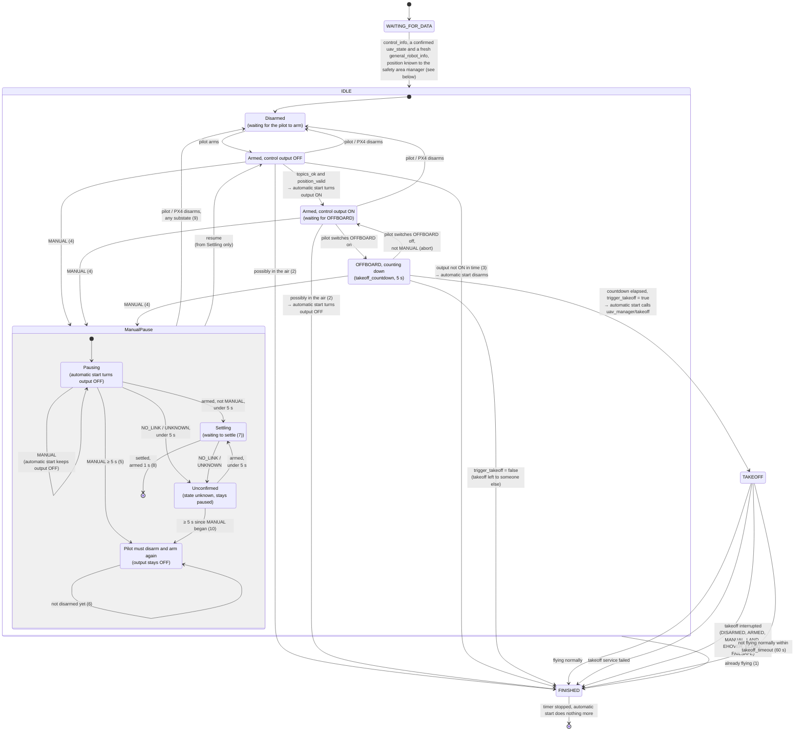

# MRS UAV Autostart

Please follow to the [documentation page](https://ctu-mrs.github.io/docs/features/autostart/).

## Changes compared to the original version

Compared to the ROS1 version (`master`) and to the first ROS2 port (`ros2` before automatic start
was moved onto DiagnosticsManager):

- **Inputs**: automatic start reads only DiagnosticsManager (`uav_state`, `control_info`,
  `general_robot_info`) and, in simulation, the Gazebo spawner. It no longer subscribes to the HW
  API, EstimationManager, ControlManager, UavManager or SafetyAreaManager.
- **Preflight checks** (speed, height, gyro, topics, position in the safety area) are computed by
  DiagnosticsManager and read from `general_robot_info.preflight_status`. The `preflight_check/*`
  parameters moved to `mrs_uav_managers` (`config/public/diagnostics_manager/preflight_check.yaml`)
  with the same defaults; automatic start no longer reads them from its own config.
- **Already flying**: if MRS already flies the UAV (e.g. the node was restarted mid-air), automatic
  start finishes without touching control output, arming or takeoff. Before, it counted down and
  called `uav_manager/takeoff`, which UavManager refused (it requires `NullTracker`), so automatic
  start finished on a failed takeoff.
- **The pilot takes over (`MANUAL`)**: new. Automatic start turns control output OFF and pauses.
  After a short `MANUAL` (an aborted OFFBOARD, under 5 s) it resumes; after a longer one the pilot
  must disarm and arm again. Before, there was no pause: the "possibly in the air" check finished
  automatic start for good.
- **Disarming by automatic start**: still only when it cannot turn control output ON within
  `arm_to_output_timeout` (1.5 s) after the pilot armed. The timeout now also waits until the
  DiagnosticsManager data is available, and automatic start never disarms a UAV that the pilot armed
  before automatic start came up. Before, such a UAV was disarmed 1.5 s after the data arrived.
- **Takeoff monitoring**: after calling `uav_manager/takeoff`, automatic start finishes when the
  takeoff is interrupted (`DISARMED`, `ARMED`, `MANUAL`, `LAND`, `EHOVER`, `ELAND`, `FAILSAFE`) or
  the UAV is not flying normally within `takeoff_timeout` (60 s). Before, it waited for the takeoff
  forever.
- **Stale data**: if DiagnosticsManager stops publishing `general_robot_info` for
  `diagnostics_manager_timeout` (3 s), automatic start pauses until the data is back. Before, the
  data only had to arrive once.
- **Errorgraph**: missing data is reported as waiting for DiagnosticsManager. The first ROS2 port
  reported each manager separately; the ROS1 version had no errorgraph.
- **Parameters**: new `manual_abort_max_duration` (5 s), `takeoff_timeout` (60 s) and
  `diagnostics_manager_timeout` (3 s); `preflight_check/*` removed (see above). Since the first ROS2
  port: `safety_timeout` is `takeoff_countdown`, `handle_takeoff` is `trigger_takeoff`,
  `control_output_timeout` is `arm_to_output_timeout`, `pre_takeoff_sleep` and `body_frame_name` are
  gone, and an old parameter name in a custom config stops the node.
- **Topic renamed**: `~/can_takeoff` is now `~/ready_to_enable_control_output` (same meaning: topics
  ok and position valid).
- **After finishing** (since the first ROS2 port): the node stays alive and does nothing; the ROS1
  version shut itself down.

## State machine

This section describes how `automatic_start` behaves (`src/automatic_start.cpp`, `timerMain()`,
running at `main_timer_rate`). It reads everything from DiagnosticsManager (`uav_state`,
`control_info`, `general_robot_info`). Automatic start itself only turns control output ON and OFF
(`control_manager/toggle_output`), disarms the UAV in one case (`hw_api/arming`, note 3) and calls
`uav_manager/takeoff`. It never arms the UAV and never switches OFFBOARD: arming, OFFBOARD, flying
in `MANUAL` and disarming are done by the pilot (and PX4 may disarm by itself after a landing).

Notes:

1. **Already flying**: `uav_state` is `TAKEOFF`, `HOVER`, `GOTO`, `TRAJECTORY`, `LAND`, `RC_MODE`,
   `MIDAIR`, `EHOVER`, `ELAND` or `FAILSAFE` — someone else started the flight (e.g. the node was
   restarted mid-air, or MRS is taking over a UAV already in the air). Automatic start finishes
   without touching output, arming or takeoff. `MANUAL` does not count as already flying, see
   `ManualPause` below.
2. **Possibly in the air**: not OFFBOARD, a preflight speed / height / gyro check failed, and the
   UAV is armed. If automatic start turned control output ON, it turns it OFF again, then finishes.
   While **not armed** it only warns and keeps waiting. This check can't fire during a `ManualPause`
   (the pause is checked first), and the `Settling` wait (note 7) keeps it from firing right after a
   resume.
3. **Output not ON in time**: automatic start could not turn control output ON within
   `arm_to_output_timeout` (1.5 s) after the pilot armed (or after the data became available), e.g.
   because a topic check or the safety area check fails. Automatic start then disarms the UAV and
   finishes. This is the only case in which it disarms. It does not disarm if the UAV was already
   armed when automatic start came up: then it only warns and keeps waiting.
4. **`MANUAL`**: the pilot (or the autopilot itself) is flying without offboard. Automatic start
   keeps control output OFF for the whole pause, so MRS can't take over when the pilot switches
   OFFBOARD on again (it would find no setpoints). `Disarmed` can't reach `ManualPause`:
   `uav_state == MANUAL` requires the UAV to be armed.
5. **Long `MANUAL`**: a `MANUAL` that lasts `manual_abort_max_duration` (5 s by default) or longer
   is treated as a real flight, not an aborted OFFBOARD attempt. To use automatic start again, the
   pilot must disarm and arm again.
6. Only a disarm by the pilot or PX4 (`uav_state` `DISARMED`) ends `NeedsRearm`; `NO_LINK`/`UNKNOWN`
   are ambiguous (not a confirmed landing) and leave the pause exactly where it was. A `MANUAL`
   reading after `Settling`/`Unconfirmed` goes back to `Pausing` (not drawn); the 5 s keeps counting
   from when the first `MANUAL` began.
7. **Settling**: once a short `MANUAL` ends, resuming is deferred while the preflight
   speed/height/gyro heuristics still say "possibly in the air" and the UAV isn't OFFBOARD yet —
   otherwise resuming would immediately trip the "possibly in the air + armed" finish check (note 2)
   right after the pause.
8. Resume requires `armed` to be stable (uninterrupted) for 1 s once `Settling`'s condition clears.
9. A disarm by the pilot or PX4 ends the pause from any substate (short or long): the pause and the
   rearm requirement are cleared and automatic start continues from `Disarmed`, so the pilot's next
   arm is a fresh start (the arm-to-output timeout counts from the new arming). `started_armed_` is
   **not** reset — it is latched once, from the first confirmed `uav_state` at node startup, so
   automatic start never disarms a UAV that the pilot armed before automatic start came up, even
   after a pause.
10. **Unconfirmed**: during a short pause, `NO_LINK`/`UNKNOWN` keeps automatic start paused (it
    warns "paused, UAV state not confirmed"). The pilot may still be flying without automatic start
    seeing it, so once `manual_abort_max_duration` has passed since the `MANUAL` began, the pilot
    must disarm and arm again, just like after a long `MANUAL`. The time is measured from when the
    `MANUAL` began, so it includes any time already spent in `Settling`: a `NO_LINK`/`UNKNOWN`
    reading ≥ 5 s after the `MANUAL` began needs a rearm straight away. A long `Settling` while
    confirmed armed (not `MANUAL`) never requires a rearm by itself.

- `WAITING_FOR_DATA` is not a state of its own: the data check runs at the top of every
  `timerMain()` tick, in every state. Until `control_info`, a confirmed `uav_state` (not
  `NO_LINK`/`UNKNOWN`) and a `general_robot_info` with `preflight_status.position_known` have
  arrived, the tick does nothing and reports DiagnosticsManager in the errorgraph.
  `general_robot_info` must also be fresh: if it is older than `diagnostics_manager_timeout` (3 s),
  e.g. because DiagnosticsManager died, `IDLE` and `TAKEOFF` pause the same way until the data is
  back.
- The checks run in this order on every tick of `IDLE`: already flying → `MANUAL` pause/resume →
  preflight "possibly in the air" → turning control output ON (arm-to-output timeout) → (simulation
  only) Gazebo spawner finished → OFFBOARD countdown.
- Automatic start never disarms the UAV while it is in OFFBOARD.
- `FINISHED` is final: to use automatic start again, restart the node.

### Transitions and the tests that cover them

The simulation tests are in `test/<name>/`. How every `uav_state` is classified
(`include/mrs_uav_autostart/state_checks.hpp`: confirmed, armed, flown by MRS, takeoff interrupted) is
unit-tested in `test/state_checks`.

| Transition                                                                                                                         | Test (`test/`)                                                                                                              |
|------------------------------------------------------------------------------------------------------------------------------------|-----------------------------------------------------------------------------------------------------------------------------|
| `WAITING_FOR_DATA` → `IDLE`                                                                                                        | `errorgraph_clears_after_startup` (waiting-for-DiagnosticsManager error reported, then cleared)                             |
| `IDLE` → `FINISHED`: already flying                                                                                                | `already_flying_should_finish`                                                                                              |
| `ManualPause` → `FINISHED`: already flying (`MIDAIR`), control output turned ON by UavManager is left alone                        | `midair_activation_should_finish`                                                                                           |
| `Disarmed` → `ArmedOutputOff` → `ArmedOutputOn`                                                                                    | `takeoff_should_succeed`                                                                                                    |
| `ArmedOutputOff`/`On` → `Disarmed`: the pilot disarms (outside a `MANUAL` pause)                                                   | `disarm_should_start_over` (the pilot disarms with output ON, then a normal takeoff after arming again)                     |
| `ArmedOutputOff` stays: `topics_ok` false                                                                                          | `topic_check_failure_should_disarm` (output never ON, takeoff fails, automatic start disarms)                               |
| `ArmedOutputOff` stays: position outside the safety area                                                                           | `outside_safety_area_should_disarm` (output never ON, takeoff fails, automatic start disarms)                               |
| `ArmedOutputOff`/`On` → `FINISHED`: possibly in the air + armed                                                                    | `takeoff_should_fail_while_moving`                                                                                          |
| Armed by the pilot before automatic start came up: output ON, takeoff                                                              | `started_armed_should_take_off`                                                                                             |
| Armed by the pilot before automatic start came up: automatic start does not disarm on the arm-to-output timeout                    | `started_armed_should_not_disarm`                                                                                           |
| `ArmedOutputOn` → `Countdown` → `TAKEOFF` → `FINISHED` (flying normally)                                                           | `takeoff_should_succeed`                                                                                                    |
| `Countdown` → `FINISHED`: `trigger_takeoff = false`                                                                                | `trigger_takeoff_off_should_finish`                                                                                         |
| `ArmedOutputOff`/`On`/`Countdown` → `ManualPause` (`Pausing`): `MANUAL`                                                            | `manual_flight_should_pause` (long), `short_manual_should_resume` (short, from `Countdown`)                                 |
| `Pausing` → `Pausing`: output forced OFF on every tick while `MANUAL`                                                              | `manual_flight_should_pause`                                                                                                |
| `Pausing` → `NeedsRearm`: `MANUAL` ≥ 5 s                                                                                           | `manual_flight_should_pause`                                                                                                |
| `NeedsRearm` → `NeedsRearm`: `NO_LINK` doesn't end the pause                                                                       | `manual_flight_should_pause`                                                                                                |
| `NeedsRearm` → `Disarmed`: the pilot disarms, fresh start after arming again                                                       | `manual_flight_should_pause`                                                                                                |
| `Pausing` → `Unconfirmed` → `NeedsRearm`: short `MANUAL` (~2 s) + long `NO_LINK` (~5.5 s), then `ARMED` doesn't resume             | `manual_flight_should_pause`                                                                                                |
| `Pausing`/`Settling`/`Unconfirmed` → `Disarmed`: the pilot disarms during a short pause                                            | **no test**                                                                                                                 |
| `Pausing` → `Settling`: `MANUAL` ends before 5 s                                                                                   | `short_manual_should_resume`                                                                                                |
| `Settling` → resume (armed stable 1 s) → `ArmedOutputOff`/`On` → `Countdown` (restarted, no takeoff for the first 3 s) → `TAKEOFF` | `short_manual_should_resume`                                                                                                |
| `ArmedOutputOff` → `FINISHED`: arm-to-output timeout → automatic start disarms                                                     | `outside_safety_area_should_disarm`, `topic_check_failure_should_disarm`                                                    |
| `Countdown` → `ArmedOutputOn`: the pilot switches OFFBOARD off *without* `MANUAL`, then on again                                   | **no test** (`short_manual_should_resume` covers the `MANUAL`-abort path above instead, which is what PX4 actually reports) |
| `Settling` → `Settling`: stays because speed/height/gyro not ok                                                                    | **no test** (`short_manual_should_resume`'s mock always reports the heuristics as ok)                                       |
| `TAKEOFF` → `FINISHED`: takeoff service failed                                                                                     | `takeoff_failure_should_finish`                                                                                             |
| `TAKEOFF` → `FINISHED`: takeoff interrupted (`MANUAL`), finishes without touching output or arming                                 | `takeoff_interrupted_should_finish`                                                                                         |
| `TAKEOFF` → `FINISHED`: `takeoff_timeout`, finishes without touching output or arming                                              | `takeoff_timeout_should_finish`                                                                                             |
